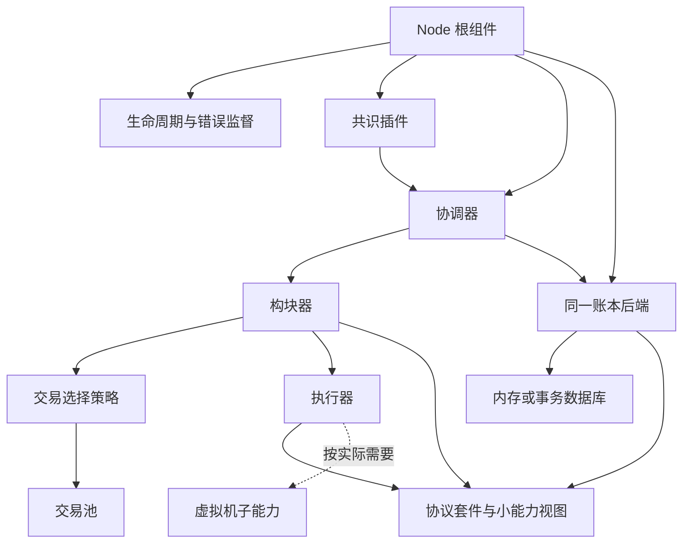

# GoChainKit 架构评估

> 文档类型：历史评估（2026-10-17），按 [归档索引](archive/index.md) 保留原路径。正文问题描述仅代表当时基线；当前接口以 [interfaces](interfaces.md)、能力状态以 [status](status.md) 为准。
> 已解决：账本 owner、交易处置、Node 运行、能力拆分；显式删除、网络同步和分支也已有实现。本文中的旧路径/类型说明不作为当前 API。原 runtime/ledger 已移除，源码链接指向现有存储助手便于追溯，不表示旧函数仍存在。

日期：2026 年 10 月 17 日。评估基于目录简化后的代码，覆盖 core、node、plugins、默认协议、共享存储及集成装配。本文给出后续建议，不表示建议已经实现。

## 总体判断

项目已经建立可替换协议的组件库，默认 KV 协议和另一种自定义格式都能完成出块、落盘、重开及继续执行。下一阶段应优先完善可信装配、节点运行生命周期和交易错误策略，让这些组件能够可靠组合成运行中的节点。

继续增加接口数量的收益有限。重点是让每个接口对应真实替换需求、明确资源归属，并让配置错误在启动时暴露。

## 已验证的基线与问题

目录简化已完成：插件按能力分包，默认类型与协议实现同包；插件 kind 保持不变。全仓 race 测试、go vet 和差异检查通过。

另用仓库外的临时程序复现了两个现有测试没有阻止的行为：

1. 两个相同协议的独立内存账本 A、B 可以通过构造校验。Coordinator 从 A 读状态、向 B 提交时，Commit 返回成功，B 链头推进，A 链头不变。
2. 初始状态接受一笔签名有效、nonce 为 2 的交易入池；执行阶段发现序号不连续，错误逐层传播，单节点共识循环在 context 仍有效时退出。

这两项是优先处理的现有行为问题；下面其他项目分别属于运行能力缺口、接口演进或简化建议。

## 一 现在必须明确的抽象

### 1 同一账本的原子边界

证据：[CoordinatorDeps](../node/coordinator.go) 独立注入 Chain、States、Committer，构造时仅核对协议身份。[当前存储准备实现](../plugins/storage/helpers.go) 接收 ChainStore 后又运行时断言它实现 StateStore。

协议相同只能说明规则相容，不能证明这些依赖连接同一份数据。

建议：保留消费方的小型读取接口，但根装配只选择一个 Ledger 后端，由它提供区块、状态、交易查询和原子提交能力。协调器从同一个账本取得执行基线与提交入口；确需独立配置视图时，显式核验账本身份。内部 Prepare 用显式组合接口或参数表达所需能力，消除隐藏断言。

区块、状态、交易、回执和链头的写入必须继续属于一个后端事务，不拆成互不关联的写插件，也不引入跨数据库两阶段提交。

### 2 错误与交易处置语义

证据：[交易池](../plugins/mempool/memory.go) 做无状态验证，[KV 执行器](../plugins/executor/kv.go) 校验连续序号；[构块器](../plugins/builder/basic.go) 将执行错误返回给 [单节点共识](../plugins/consensus/single.go)，后者遇到任何宿主错误都会退出。

至少区分：

- 永久无效交易：拒绝或从池中驱逐。
- 暂不可执行交易：保留并延后，例如前置序号尚未到达。
- 暂无候选或可恢复竞争：等待下一轮或有界重试。
- 执行器、数据库或协议内部错误：停止相关流程并上报。

先提供最小分类和有界处置策略即可，不必立刻实现完整账户索引交易池。不能用错误字符串判断类别，也不能把一笔交易暂不可执行等同于节点不可继续工作。

另外，Coordinator 已落盘后清理交易池失败，目前返回带文字上下文的普通 error。建议提供可识别的“已提交但清理失败”结果或错误类型，与 ErrCommitUnknown 区分，避免调用者将已提交交易当作失败而盲目重试。

### 3 节点运行与资源 owner

证据：[node 插件](../plugins/node/coordinator.go) 返回 ConsensusHost，尚不是可运行的 core.Node。集成测试手动启动和关闭数据库；当前没有独立节点命令或配置文件启动入口。

建议增加一个根 Node/Runner，使用现有 PluginKit 构造依赖图。推荐先以 Run(ctx) 返回终止原因，由它负责：

1. 去重共享资源并按依赖顺序启动。
2. 部分启动失败时回滚。
3. 并行驱动共识、入口服务和未来传输任务。
4. 传播致命错误、取消其他任务并逆序释放资源。

只对数据库、服务和后台任务赋予生命周期；纯协议、编码器和普通策略不需要空的 Start/Stop。Node 的错误等待契约要明确，避免异步共识退出后进程仍显示正常。

## 二 适合作为依赖子插件的能力

### 1 交易选择与构块策略

目前 Mempool.Select 同时承担候选保管、顺序和字节预算选择。建议交易池负责容量、去重和候选保管，构块器注入一个默认选择策略，负责顺序、预算和暂不可执行交易的处理。

这是当前已有真实变化需求的子插件：FIFO、序号依赖、优先级和系统交易都属于选择策略的变化。先只提供一个默认实现，不预建复杂调度体系。

### 2 协议能力组合

core 已拆出 TransactionCodec、BlockCodec、BlockFactory、校验和 StateCommitter，但目前通用依赖仍全部声明为 core.Protocol。

建议保留 Protocol 作为一致的协议套件，同时让具体消费者声明其实际需要的小能力组合。例如交易池只需要交易编解码与无状态校验；状态相关模块只取得必要的承诺能力。仍保留协议身份核对。

这些小接口可以由同一个实例实现，也可以由协议构造器组合。暂时没有必要把每个方法都注册成单独插件。

### 3 VM 或业务执行引擎

Executor 继续负责链级交易语义，例如账户序号、费用和状态变更；当实际接入虚拟机时，可以在执行器内部注入 VM 子能力。

VM 不直接推进链头，不决定最终性，也不绕过 Committer 写数据库。等接入真实 VM 再确定调用上下文、资源计量和宿主函数接口，避免现在设计一个覆盖所有虚拟机的大接口。

### 4 有条件拆分的密码学和规则实现

默认 KV 的 Ed25519、SHA-256 和 JSON codec 放在默认协议内是合理的。出现实际多算法、多编码或规则复用需求时，再向协议构造器注入对应实现。

算法变化属于协议身份和兼容性问题，不能把任意替换算法当作同一条链的普通运行配置。

## 三 应预留的能力

### 状态应用与增量承诺

StateReader 强制提供 Entries，执行与提交阶段复制整份状态，每块保存完整快照。ExecutionResult 目前只有 Writes，没有明确删除语义。

小规模参考实现可以保留。大状态或 UTXO 等需要删除能力的实现接入前，应明确写入/删除变更集、隔离状态视图、应用变更和计算承诺的边界，允许增量树或有界遍历。

状态树的算法与承诺格式由链协议约束；数据文件与物理事务由后端负责。快照是后端产生和释放的资源句柄，通常不应独立配置成另一个插件。

### 网络同步与分支选择

当前只有传输契约，没有对等网络和同步实现。预留入口时应区分消息传输、区块获取与同步、共识消息，以及候选分支选择。所有落入 canonical 状态的数据继续经过统一验证与提交路径。

多头、DAG、GOVM 多链引用可通过可选图读取或分支能力扩展；不向所有区块接口添加统一 Height、Parent、LeftChild 等字段。当前单 head 存储能力不能被描述成已支持任意拓扑。

### 执行上下文与验证结果复用

目前 Executor 既处理草稿，也处理已定稿区块；执行结果的 BlockID 会从草稿 ID 重新绑定为最终 ID。需要写清执行器可依赖哪些内容、哪些字段不应影响执行；出现第二种复杂执行引擎时，再考虑显式只读 ExecutionInput。

本地出块在 Build、Validate、Commit 阶段执行三次，另有存储验证。当前保留这些安全边界。重型执行器接入后，可用内部可信结果绑定父状态版本、最终区块 ID 和协议身份，减少重复计算；事务内仍重新检查链头，不能相信调用者传入的公开“已验证”标志。

### 观测和提交后扩展

节点需要可查询的运行状态、结构化错误以及关键阶段的耗时与资源指标。先采用明确的组件调用和提交后通知；业务通知不得反向影响已提交状态。

没有需求时不建立全局事件总线或拦截所有方法的通用中间件系统。

## 四 可以继续简化的部分

1. plugins 已按能力合并目录，默认协议已扁平化，当前深度足够；不再为每个接口单建包。
2. runtime/ledger 在目录合并后只有 plugins/storage 一个消费包。可以将准备逻辑和快照助手收回 storage 包内部，降低导出面；出现第二个独立消费者时再提取共享包。
3. 默认协议中未被使用的 ConfirmedTransaction、ExecutionResult、Genesis 等重复 DTO 可以删除，避免与 core 中的通用记录混淆。先确认引用再移除。
4. core.Hasher、Verifier 等尚无消费者的占位接口可以延后；core.Node、API 目前只是 Lifecycle 的别名，应在确定运行契约时补实或暂不公开。
5. 减少重复配置源，例如默认执行器的 ChainID 与协议描述符的 Network；优先从已选协议派生，并在确需独立限制时显式校验。

薄注册适配包仍有作用：protocol/kv 提供可复用的协议与客户端格式，plugins/protocol 负责选择注册；node 的运行逻辑不因普通导入而产生注册副作用。无需仅因文件少就合并这些职责。

## 五 应保持分离的边界

- 通用 core 与具体协议格式。
- 协议套件与有状态执行器。
- 交易候选保管与选择/处置策略。
- 共识的最终性判断与存储的原子提交。
- 后端事务 owner 与它产生的读取视图。
- 生命周期编排与 PluginKit 类型注册。
- 本地数据库封装格式与链上规范编码。
- 持久化前验证与提交后的通知、交易池清理。

存储内部 gob、bucket、文件锁不需要变成链开发者必须理解的插件。原子事务也不应被拆散为若干独立写步骤。

## 建议的依赖方向

以下为目标组织草图，尚未实现新增组件：

## 推进顺序

第一批：修复同账本绑定、交易错误分类与出块存活性，明确提交结果语义，并补回归测试。

第二批：补可运行 Node 根组件、最小配置入口和默认 preset，建立启动失败回滚及关闭验证。

第三批：缩小消费方协议依赖，增加默认交易选择策略，清理无消费者接口和重复 DTO；将仅存储使用的助手内部化。

后续按真实需求推进状态增量/删除、VM、同步与分支能力。当前不扩展完整分布式共识、通用事件总线或插件热加载。

本文仅记录架构建议与复现结果。除已授权的目录简化外，本轮没有修改上述行为问题或实施建议中的新能力。

## 执行进展

本评估的前三批已落实：Ledger owner 绑定、候选前置绑定、交易错误分类与有限重选、提交后维护结果、根 Node 生命周期监督、配置与 CLI、消费者能力拆分、selector 子插件与内部存储助手。完整运行契约见 node-runtime.md，接口见 interfaces.md。上文风险描述代表评估时状态，不代表这些缺陷仍存在。状态树、VM、网络与多节点共识仍按实际需求推进。
