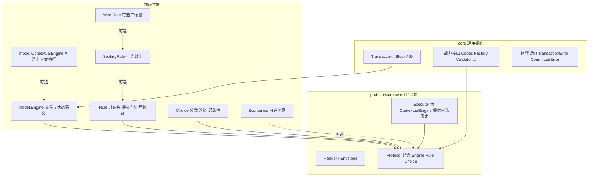

# 组合协议抽象与接口评估

日期：2026 年 10 月 17 日。本文从抽象与接口定义层面评估 `protocol/composed` 及其关联抽象（`core` 能力接口、`model.Engine`、`Rule`、`Choice`），给出后续建议。除特别说明外，建议尚未实现；现状描述以当前代码为准。

## 抽象分层现状

三个设计决策构成当前抽象的骨架：

1. **core 不规定格式**。`Transaction`/`Block` 只要求稳定 ID；header、账户、nonce、父块拓扑全部留在具体协议。
2. **组合而非枚举**。`Protocol` 由 Engine、Rule、Choice 三个独立依赖装配，不按模型名或共识名分支；缺能力在装配时拒绝（如 Economics 要求 `asset.Currency`）。
3. **能力按可选性分层**。`Rule` 是必要能力；`SealingRule`、`WorkRule`、`Economics`、`ContextualEngine` 是可选增量，旧实现无需空实现这些方法。

这些决策与 [模块与协议接口](interfaces.md)、[开发规范](development-conventions.md) 一致，应继续保持。

## 已符合良好实践的接口形态

### 1 Rule 与 Choice 的职责分离

`Rule` 负责共识头字节（`Draft`/`Genesis`）与提案/证明验证（`Validate`，bool 区分提案与已封印）；`Choice` 负责 `Score`/`Prefer`/`Finalized`。两者互不知晓，各自用 `ID()` 把完整语义参数绑定进创世。

`Draft` 的确定性契约（必须由父块与传入头确定，禁止本地时钟、签名者替换、随机源）是关键正确性条件：`executor.go` 在执行视图中清空执行承诺后重建 `Draft`，保证初次执行与网络重放得到相同候选 ID。该契约已写入接口注释，属于接口文档化的正面样例。

### 2 可选能力以接口增量表达

`SealingRule`、`WorkRule`、`Economics`、`ContextualEngine` 都是「基础接口 + 附加方法」的增量，消费方用类型断言探测，缺失时走默认路径。这符合「接口围绕替换需求定义、不为每个结构体机械建接口」的规范。

### 3 执行与历史解耦

`composed.Executor` 独立于 `Protocol` 构造，只为 ContextualEngine 注入只读 `BlockHistory`，避免协议与账本之间的构造依赖环；`executionHistory` 锚定执行父块、剥离 Proof 旁证、对非祖先 ID 返回 `ErrNotFound`，把「模型可见的历史」收敛为确定性输入。

## 改进建议

以下按优先级排列。注释、能力缓存与具名上下文接口保持已验证的行为契约；状态校验扩展及子插件拆分属于后续设计，需单独验证。

### 1 把 Rule 的执行顺序与状态隔离写成显式契约

现状：`Rule.Validate(ctx, store, parent, envelope, sealed)` 的调用时机（Finalize 前查提案、封印后查证明）依赖注释说明，`Seal` 与执行的先后关系也只体现在 `pow` 运行器代码中。

建议：在 `contracts.go` 的接口注释之上，增加一段独立的执行顺序契约，明确：

- `Validate(sealed=false)` 在 `Finalize` 绑定执行承诺之后、`Seal` 之前调用；
- `Seal`（若提供）之后必须再次 `Validate(sealed=true)`，持久化路径的 `ValidateBlock` 拒绝未封印提案；
- 当前 Rule 的方法不接收 `StateReader`；保持现有历史校验路径。未来状态感知规则通过独立可选能力获得绑定父块的确定性输入，不直接修改状态，不把这一阶段的签名限制上升为永久约束。

这是纯文档化改动，但能把「封印后必须复验」从插件实现约定升级为接口契约，降低第三方 Rule 实现出错的空间。

### 2 收敛 Economics 的类型断言路径

现状：`protocol.go` 构造时检查「Economics 启用则 Engine 必须实现 `asset.Currency`」，`executor.go` 执行期再次断言。两个检查点重复，且执行期的 `p.engine.(asset.Currency)` 依赖构造期检查不变。

建议：在 `New` 中完成能力解析后，把 `asset.Currency` 存为 `Protocol` 的显式字段（可为 nil），执行期只读取该字段。断言点收敛到一处，能力组合在构造时定型，也便于后续增加其他可选资产能力（如 Escrow 适配）时复用同一模式。

### 3 明确 Economics 的语义归属

现状：`Economics` 接口（`Enabled`/`Reward`）定义在 composed 包，但只有「Rule 实现它」才生效——这是隐含约定，接口本身没有说明为什么奖励额度属于规则而非模型。

建议：在注释中写明设计理由并考虑命名强化：奖励金额是**共识规则**的语义（如 PoW 减半计划），发放通道是**模型能力**（`asset.Currency.Credit`）。因此 `Economics` 必须由 Rule 提供、由 Protocol 消费，模型不决定奖励额度。若未来出现模型侧费用规则（如燃烧比例），应另立接口，不并入 Economics。

### 4 执行上下文的可选能力登记

现状：`executionContext` 通过具体类型额外暴露 `Height()`、`Timestamp()`、`StateCommitment()`，模型以类型断言获取。可用能力清单只散落在实现里，模型作者无法从接口定义知道可以断言什么。

建议：在 `model` 包定义具名的可选能力接口（如 `HeightContext`、`TimestampContext`、`StateCommitmentContext`），让 composed 的上下文实现它们，而不是暴露具体类型的裸方法。模型断言标准接口，其他协议族提供上下文时也能复用同一组断言目标。基础 `ExecutionContext` 保持三个方法不变，不给所有模型强加高度/时间字段。

### 5 Choice 的分数不透明性需要配套文档

现状：`Score` 返回 `[]byte`（不透明），`Prefer` 接收两份分数。这是正确的抽象（不同规则的分数不可比），但「为什么不用 `big.Int`」对读者不直观——`WorkRule.Work` 返回 `*big.Int`，两条路径并存容易误解。

建议：在 `Choice` 注释中补一句：分数编码由 Choice 实现自定义，`Prefer` 是唯一比较入口，调用方不得解析或排序分数字节；`WorkRule.Work` 表达具体工作量能力，工作量 Choice 可以使用它计算累计分数，但通用调用方不得假设它与任意 Choice 分数存在换算关系。

### 6 评估 Header 固定字段的最小化

现状：`Header` 固定包含 `Height`、`Timestamp`、`Producer`、`TransactionsRoot/StateRoot/ReceiptsRoot`。这比 core 的最小接口具体得多，但仍是「composed 封装族内部」的格式，不污染 core——边界正确。

暂不改动，仅记录两个未来压力点：

- 若出现不需要 receipts 的组合，`ReceiptsRoot` 的空值编码规则需写入契约（当前为固定字段默认编码）；
- `Consensus []byte` 是 Rule 的自由域，长度上限目前由 Rule 自行约束；若未来 Envelope 有总大小限制，应说明 Consensus 计入哪一部分。

### 7 不建议的改动

为避免过度设计，明确排除以下方向：

- **当前不机械细分 Rule/Choice**：按独立职责与真实替换需求决定边界；出现可独立替换的证明验证、成员规则等能力时再通过 deps 组合，不能因方法多就拆，也不能禁止未来拆分。
- **不给规则任意本地状态访问**：DPoS 等规则确实需要权益、委托和验证者集合。可通过可选校验能力读取绑定执行父块的只读确定性视图，或核验可验证的状态证明；本地出块与网络导入必须执行相同校验。有效性校验不应仅因需要状态就移入 Choice。具体接口待真实调用点确定，禁止读取当前可变主链状态。
- **不统一 kv / powkv / composed 的 Header**：三条路径服务不同阶段，强行共享格式会污染 core 的最小边界；选型分工见架构评估文档。

## 执行顺序参考

第一批（纯文档化，无行为变化）：建议 1、3、5。

第二批（小重构，需回归测试）：建议 2、4。

建议 6 在有第二个组合实例（如 DPoS 规则）出现时再评估；建议 7 中的排除项长期有效。

## 接口必要性与插件组合规范

本节是后续设计和评审的约束；除前文标明的现状外，不表示已经完成代码迁移。参考本机 AgentKit v0.4.0 的 `plugins/schedule/multi.go`（类型化依赖）、`plugins/agent/chain/chain.go`（同类能力组合）及 `plugins/hook/turnnudge.go`（空 Deps 预留）。

### 接口准入与职责边界

新增接口必须说明：谁消费、替换什么能力、为什么不能复用现有契约，以及失败、并发、生命周期与确定性要求。一个实现也可以建立必要的模块边界，但不能只以“以后可能有用”作为新增接口的依据。没有独立调用方或替换语义的辅助函数保留为包内实现。

高内聚以一个完整职责为单位：交易选择、状态执行、证明验证、选链分别有自己的输入输出和不变量。单一职责不等于一个方法一个插件；必须共同维护的不变量和原子事务应留在同一所有者内。例如区块、状态、回执和链头的原子提交不能为了拆插件变成多个独立提交。

低耦合要求消费方只依赖实际使用的能力接口，不依赖其他插件的具体类型、内部字段、算法名称或全局注册表。领域实现不依赖 PluginKit 装配机制；插件层负责把领域实现接入配置图。

### Config / Deps / 构造函数

- 插件入口采用类型化的 `NewX(Config, Deps) (能力接口, error)`；无依赖的叶子插件可以预留空 `XDeps struct{}`，不填入虚构依赖。领域构造函数可保留自然签名，由薄插件适配层调用。
- Config 保存参数，Deps 保存外部能力。可替换的子能力通过 Deps 注入，不在 Config 放实现对象，不在运行时按字符串查服务，不在父插件中硬编码创建另一个已注册插件。
- Deps 字段使用最小足够的能力接口和明确的配置标签；必需依赖缺失在构造期失败。可选依赖必须定义缺失行为，不静默替换用户明确配置的错误依赖。
- 预留 Deps 是预留构造入口，不是预先加入一组可选字段。仅在消费方存在真实替换需求时增加字段；不使用 `map[string]any`、万能容器或服务定位器。
- 在构造期核对协议、创世、账本所有者及必要能力组合。依赖持有者不默认拥有关闭权；共享资源由明确的生命周期所有者启动和关闭，避免重复关闭及装配环。
- 组合插件可以通过一个依赖、多个具名依赖或同一接口的依赖列表完成包装、聚合与编排。顺序、错误传播和资源归属必须明确；只有可独立替换的步骤才拆为子插件。

### 当前模块的应用方向

`protocol/composed` 是 Engine、Rule、Choice 的组合适配层，负责格式绑定与跨能力一致性，不承担网络、挖矿调度或资产模型本身。`builder` 通过 Selector、Executor 等依赖完成构块，保留现有组合方向。

PoW、DPoS 的运行编排与规则验证分离；选链与最终性策略独立表达。调难、奖励、选举、投票证明等是否继续拆分，应由实际独立替换需求决定，不能先把所有算法步骤插件化。若奖励策略需要跨规则复用，再以明确的可选依赖接入，同时将其语义配置绑定链身份。

账户与 UTXO 实现只维护各自交易和状态语义；资产、托管和权益能力通过可选接口或包装插件接入。通用 Engine 不强制余额、nonce、stake 或验证者字段。状态感知的共识校验必须同时覆盖生产、重放、导入和恢复路径。

### 验收依据

必须能通过替换配置中的子插件改变目标策略，而无需修改父插件算法分支；用至少一个不同实现或测试替身验证契约和装配拒绝路径。共识与模型独立替换继续以交叉组合验证。评审同时检查：是否有不被消费的接口、过宽 Deps、隐藏构造、循环依赖、重复生命周期以及被拆散的原子不变量。

## 本轮落地状态

已落实建议 1—5：补充执行与验证顺序、奖励归属、分数不透明性契约；构造期解析并保存启用的 Economics/Currency；在 model 中公开 HeightContext、TimestampContext、StateCommitmentContext。基础 ExecutionContext 不增加必选方法。

account、UTXO 和 PoW 的插件适配入口已预留空的类型化 Deps，领域构造函数保持独立。既有 composed 和 builder 的显式依赖组合继续保留；尚未新增奖励、调难或状态感知校验子插件，相关拆分需有实际替换需求。

## 后续实现简化

执行入口已统一为独立 composed.Executor；公开的 Protocol.Execute 和 Base 桥接已移除。内部保留封装族身份解析，不将其升级成所有协议必须支持的通用接口。KV 执行逻辑移入领域层，powkv 通过显式依赖复用；领域包不依赖 plugins。编码助手保持内部共享，Envelope 以显式深复制保持所有权及 nil/空值语义。
